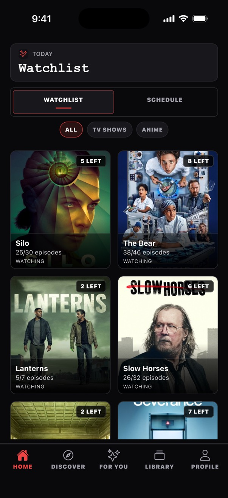

# ShowTracker

A TV, anime and movie tracker with episode progress, watchlists, release schedules, custom lists, TV Time import and watch statistics. Built with Expo, React Native and Convex.

**[Open ShowTracker](https://showtrackerapp.netlify.app)** in the browser. The same Expo codebase targets iOS and Android.



_The home watchlist. More views: [episode tracking](public/landing/show-check.jpg) · [watch statistics](public/landing/profile.jpg)._

## Features

- Discover trending TV, anime, and movies.
- Search across supported media types.
- Track episode, season, full-show, and movie watch state.
- Manage Home watchlist surfaces with released/unwatched counts.
- View tracked-show schedule and upcoming episode projections.
- Create custom lists and inspect profile/watch statistics.
- Import tracked data and repair stale tracking state with bounded tools.

## How it is built

One Expo codebase targets web, iOS and Android. Convex stores and syncs user data; provider clients normalize TMDB, TVMaze, AniList and Jikan data before it reaches the screens. The [architecture overview](docs/ARCHITECTURE.md) explains provider identity, watch state and schedule projections.

### Tech stack

- **Runtime**: Expo SDK 54, React 19, React Native 0.81, React Native Web 0.21
- **Routing**: Expo Router 6
- **Language**: TypeScript 5.9 in strict mode
- **Styling**: NativeWind 4
- **Backend**: Convex with Convex Auth
- **Client state**: Convex realtime data plus small Zustand stores for client/UI state
- **Providers**: TMDB, TVMaze, AniList, and Jikan/MAL fallback

## Building from source

Install Node.js/npm and use your own Convex project and provider credentials. Use the variable names in [.env.example](.env.example); keep your values in local environment files.

```bash
npm install
```

Run the backend in one terminal and complete Convex's setup prompts:

```bash
npx convex dev
```

Once the deployment URL is configured, start Expo in a second terminal:

```bash
npm run start:web
```

## Checks

`npm run lint` and `npx tsc --noEmit --pretty false` run static checks. `npm run schedule-confidence:validate` checks deterministic schedule fixtures. Focused behavioural suites cover schedule timing, Convex I/O and TV Time import; their commands are in [package.json](package.json). These are distinct from live-provider validation and browser inspection.

## Documentation

- [Architecture](docs/ARCHITECTURE.md)
- [Product goals](docs/GOALS.md)
- [Documentation index](docs/README.md)

## Contributing

Create a focused branch, open or update a PR, merge to `main` once checks pass, and verify the live Netlify deployment. Keep user-owned synced data in Convex, and add an ADR for any change that can affect watchlist, schedule, release availability, provider matching, or projection behavior.

## License

The source is public on GitHub. It has no open-source licence.
